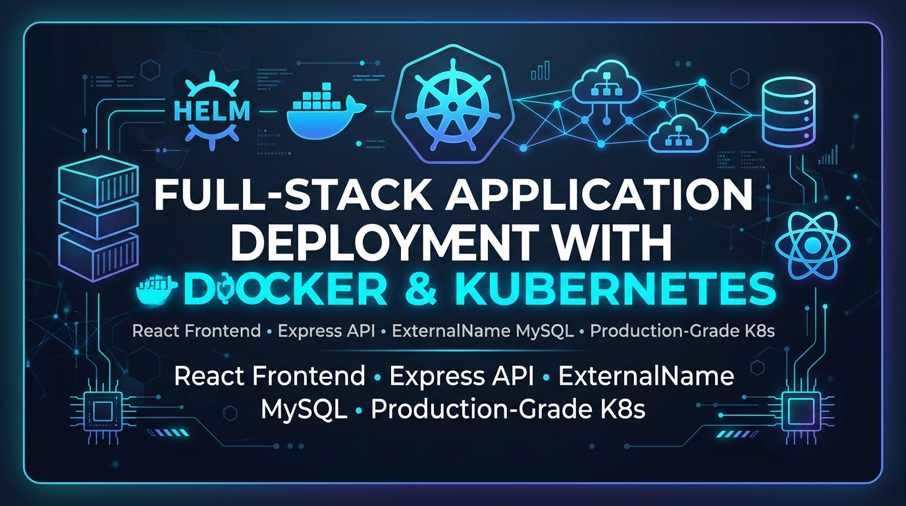
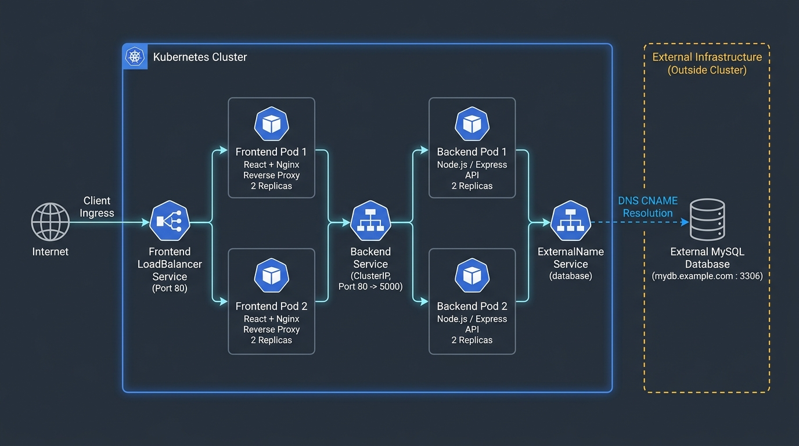
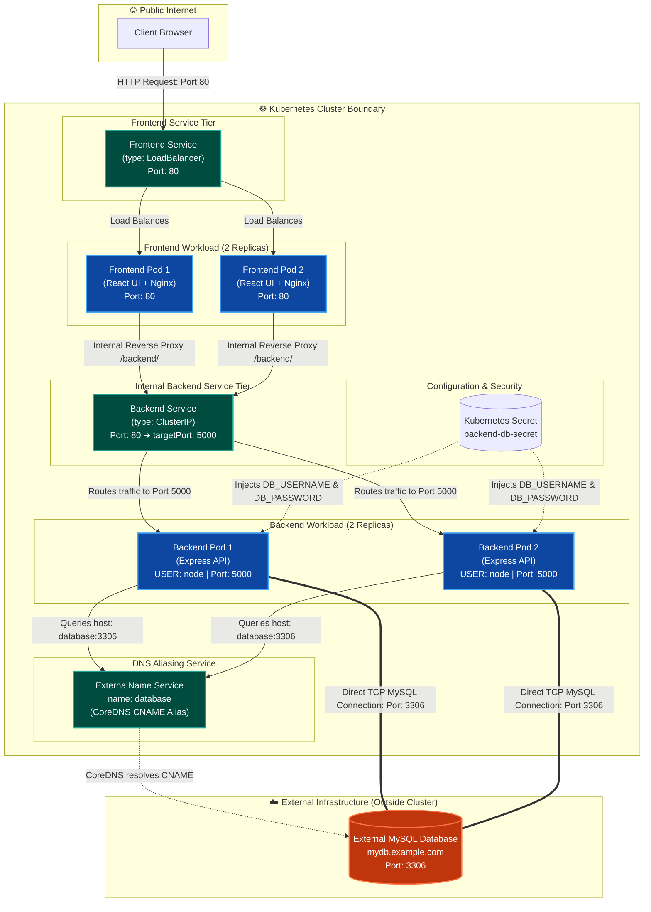
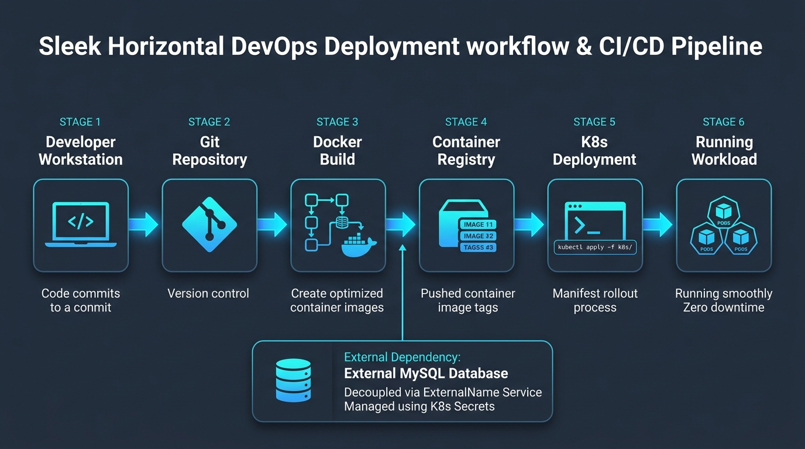
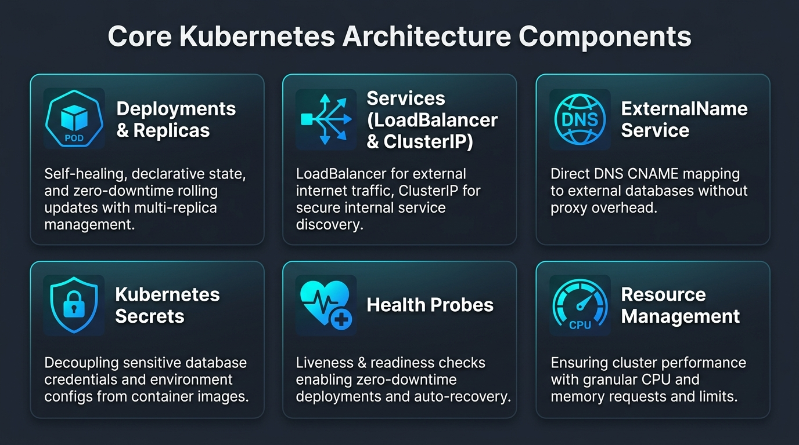

<div align="center">

# Full-Stack Application Deployment with Docker & Kubernetes



[](https://kubernetes.io/)
[](https://www.docker.com/)
[](https://react.dev/)
[](https://nodejs.org/)
[](https://expressjs.com/)
[](https://nginx.org/)
[](https://www.mysql.com/)
[](https://aws.amazon.com/eks/)
[](https://aws.amazon.com/rds/)
[](http://a2e8054e02759442eb1369bcbb8201ab-1857416283.us-east-1.elb.amazonaws.com)

<p align="center">
  <strong>Production-Grade Multi-Tier DevOps Deployment Showcase</strong><br>
  Decoupled React Frontend • Nginx Reverse Proxy • Express REST API • ExternalName MySQL Integration
</p>

> [!TIP]
> 🌐 **Live Production Cloud Deployment Verified on AWS**:
> - **Frontend Web Application**: [http://a2e8054e02759442eb1369bcbb8201ab-1857416283.us-east-1.elb.amazonaws.com](http://a2e8054e02759442eb1369bcbb8201ab-1857416283.us-east-1.elb.amazonaws.com)
> - **Live REST API Endpoint**: [http://a2e8054e02759442eb1369bcbb8201ab-1857416283.us-east-1.elb.amazonaws.com/backend/books](http://a2e8054e02759442eb1369bcbb8201ab-1857416283.us-east-1.elb.amazonaws.com/backend/books)
> - **Live Cloud Architecture**: Amazon EKS (v1.34) on x86_64 EC2 nodes + Amazon RDS for MySQL + AWS Elastic Load Balancer (ELB).

---

</div>

## 📑 Table of Contents

- [1. Project Overview](#1-project-overview)
- [2. Project Objectives](#2-project-objectives)
- [3. Key Features](#3-key-features)
- [4. Technology Stack](#4-technology-stack)
- [5. System Architecture](#5-system-architecture)
- [6. Application Request Flow](#6-application-request-flow)
- [7. Repository Structure](#7-repository-structure)
- [8. Docker Containerization](#8-docker-containerization)
- [9. Kubernetes Deployment & Manifest Reference](#9-kubernetes-deployment--manifest-reference)
- [10. External MySQL Database Architecture](#10-external-mysql-database-architecture)
- [11. Kubernetes Services & DNS Discovery](#11-kubernetes-services--dns-discovery)
- [12. Database Initialization & Configuration](#12-database-initialization--configuration)
- [13. Security & Secret Management](#13-security--secret-management)
- [14. Health Checks & Resource Governance](#14-health-checks--resource-governance)
- [15. Step-by-Step Installation Instructions](#15-step-by-step-installation-instructions)
- [16. Verification & Validation Commands](#16-verification--validation-commands)
- [17. Troubleshooting Guide](#17-troubleshooting-guide)
- [18. Future Improvements & Roadmap](#18-future-improvements--roadmap)
- [19. DevOps Skills Demonstrated](#19-devops-skills-demonstrated)
- [20. Final Public GitHub Readiness Checklist](#20-final-public-github-readiness-checklist)
- [21. Author & Contact Information](#21-author--contact-information)

---

## 1. Project Overview

This repository demonstrates an enterprise-grade DevOps deployment of a full-stack CRUD application ("Books Management System") containerized using **Docker** and orchestrated on **Kubernetes**. 

The fundamental architectural principle of this project is the **strict separation of stateless compute and stateful data**:
1. **Stateless Compute Tier (Kubernetes)**: The React single-page frontend (served via Nginx) and Node.js/Express API run as replicated, self-healing, horizontally scalable Kubernetes Pods.
2. **Stateful Data Tier (External Infrastructure)**: The MySQL database runs **strictly outside the Kubernetes cluster** (such as on AWS RDS, Google Cloud SQL, Azure Database for MySQL, or a dedicated database virtual machine).
3. **Native Kubernetes Discovery (`ExternalName`)**: The in-cluster backend connects to the external database through a Kubernetes `ExternalName` Service, which provides a transparent CoreDNS CNAME mapping without any TCP proxy or network tunnel overhead.
4. **Internal Ingress / API Reverse Proxy**: The frontend Nginx container acts as an edge reverse proxy for the browser, routing frontend static assets and proxying `/backend/` API calls internally to the backend service. This eliminates CORS complexities and prevents exposing the backend directly to the public internet.

> [!IMPORTANT]
> **External Database Architecture**: The MySQL database is hosted externally to Kubernetes. It is **never** deployed as a Pod, Deployment, or StatefulSet inside the cluster. Kubernetes only manages application compute and internal DNS resolution to the external database host.

---

## 2. Project Objectives

- **Cloud-Native Decoupling**: Isolate stateless web and API services in Kubernetes while preserving enterprise database integrity on dedicated external infrastructure.
- **Production Containerization**: Implement minimal, hardened, multi-stage Docker images based on Alpine Linux with non-root security execution.
- **Zero-Downtime Resilience**: Implement Kubernetes Deployment rolling update strategies backed by HTTP Liveness and Readiness probes.
- **Internal Service Discovery**: Leverage Kubernetes CoreDNS and Service abstraction (`ClusterIP`, `LoadBalancer`, and `ExternalName`) for clean network boundaries.
- **Security & Secret Decoupling**: Separate sensitive credentials from container images and source code via Kubernetes Secrets and environment variables.
- **Resource Governance**: Enforce CPU and Memory requests and limits to ensure predictable pod scheduling and eliminate noisy-neighbor issues.

---

## 3. Key Features

- **Multi-Stage Frontend Build**: React application compiled with Node 20 and served using an ultra-lightweight Nginx Alpine image (< 25 MB).
- **Embedded API Reverse Proxy**: Custom Nginx configuration handles client-side SPA routing (`try_files`) and transparently reverse-proxies `/backend/*` calls to the internal backend Service.
- **Hardened Backend Container**: Node.js backend runs under an unprivileged user (`USER node`) on unprivileged port `5000` to prevent container-breakout vulnerabilities.
- **High Availability**: Frontend and Backend deployments each run **2 replicas** across cluster worker nodes.
- **Declarative Kubernetes Architecture**: Fully decoupled, sequentially numbered manifests (`1-frontend.yaml` through `6-database-externalname.yaml`) for predictable, automated rollouts.
- **Zero-Overhead DNS Aliasing**: Seamlessly point to any external database FQDN via standard Kubernetes Service DNS (`database:3306`).

---

## 4. Technology Stack

| Layer | Technology | Version / Base Image | Responsibility |
| :--- | :--- | :--- | :--- |
| **Frontend** | React.js | `18.2.0` | Client-side UI, React Router DOM, Axios HTTP client, Sass |
| **Web Server / Proxy** | Nginx | `nginx:alpine` | Static asset delivery, SPA routing, reverse proxy for API traffic |
| **Backend API** | Node.js / Express | `node:20-alpine`, Express `4.18.1` | REST API endpoints, business logic, MySQL2 connection pool |
| **Database** | MySQL | `8.0` (External) | Relational persistence, hosted outside Kubernetes (e.g., RDS / Cloud SQL) |
| **Containerization** | Docker | Engine v24+ | Multi-stage image builds, minimal layer caching, `.dockerignore` |
| **Orchestration** | Kubernetes | v1.28+ | Declarative Deployments, Services, Secrets, Probes, Resource quotas |
| **Service Discovery** | CoreDNS | Built-in K8s | Internal service discovery and CNAME mapping for external hosts |
| **Configuration** | Kubernetes Secrets / Env | Opaque Secrets | Database credentials and runtime environment variable injection |

---

## 5. System Architecture

The following diagram illustrates the complete infrastructure topology, network boundaries, and component interactions:



### Logical Request Architecture (Mermaid)



### Component Responsibility Matrix

| Component | Location | Responsibility |
| :--- | :--- | :--- |
| **React Frontend** | Kubernetes (Pod) | Renders responsive UI, book catalog, addition and edit forms via React Router |
| **Nginx Web Server** | Frontend Container | Serves static assets, routes SPA URLs to `index.html`, reverse-proxies `/backend/` |
| **Express Backend** | Kubernetes (Pod) | Exposes REST endpoints (`/books`), handles validation, manages MySQL connection pool |
| **Frontend Service** | Kubernetes (`LoadBalancer`) | Exposes frontend pods to external clients via cloud/cluster load balancer on port 80 |
| **Backend Service** | Kubernetes (`ClusterIP`) | Internal virtual IP and DNS discovery for backend pods on port 80 (targets port 5000) |
| **ExternalName Service** | Kubernetes CoreDNS | Maps internal DNS alias `database` to external FQDN (`mydb.example.com`) |
| **MySQL Database** | **Outside Kubernetes** | Durable relational storage for application tables and records |

---

## 6. Application Request Flow

The system processes incoming client requests across distinct infrastructure hops:

```
[User Browser]
      │
      │ 1. HTTP GET / (Port 80)
      ▼
[Frontend LoadBalancer Service]
      │
      │ 2. Distributes to healthy pod
      ▼
[Frontend Pod: Nginx (Port 80)]
   ├── 3a. Serves static files: /index.html, JS bundles, CSS assets
   │       (SPA fallback handled by: try_files $uri $uri/ /index.html)
   │
   └── 3b. Browser initiates API call: axios.get("/backend/books")
           │
           │ 4. Nginx proxy_pass intercepts /backend/
           ▼
[Backend ClusterIP Service: http://backend:80/]
           │
           │ 5. Forwards to containerPort 5000
           ▼
[Backend Pod: Express API (Port 5000)]
           │
           │ 6. Executes query: SELECT * FROM books
           │    Connects to DB_HOST: database, PORT: 3306
           ▼
[Kubernetes CoreDNS (ExternalName Service)]
           │
           │ 7. Resolves "database" ➔ CNAME: mydb.example.com
           ▼
[External MySQL Database: mydb.example.com:3306]
           │
           │ 8. Executes SQL and streams rows back to Express
           ▼
[Express formats JSON ➔ Nginx proxies response ➔ Browser renders Books Catalog]
```

### Nginx Reverse Proxy Configuration ([`client/nginx.conf`](client/nginx.conf))

```nginx
server {
    listen 80;

    # Serve React static assets with client-side SPA routing
    location / {
        root   /usr/share/nginx/html;
        index  index.html index.htm;
        try_files $uri $uri/ /index.html;
    }

    # Proxy frontend API calls to internal Kubernetes backend service
    location /backend/ {
        proxy_pass http://backend:80/;
        proxy_http_version 1.1;
        proxy_set_header Host $host;
        proxy_set_header X-Real-IP $remote_addr;
        proxy_set_header X-Forwarded-For $proxy_add_x_forwarded_for;
        proxy_set_header X-Forwarded-Proto $scheme;
    }

    error_page 500 502 503 504 /50x.html;
    location = /50x.html {
        root /usr/share/nginx/html;
    }
}
```

---

## 7. Repository Structure

```text
kubernetes-project/
├── .gitignore                      # Root git ignore (prevents committing secrets and .env)
├── README.md                       # Comprehensive DevOps portfolio documentation
├── assets/                         # Architecture diagrams and visual infographics
│   ├── devops-banner.png           # Professional GitHub repository hero banner
│   ├── architecture-diagram.png    # High-fidelity system architecture diagram
│   ├── deployment-workflow.png     # End-to-end CI/CD and deployment pipeline infographic
│   └── kubernetes-components.png   # Visual guide to core Kubernetes objects
├── backend/                        # Node.js Express REST API microservice
│   ├── .dockerignore               # Prevents copying .env and local node_modules
│   ├── .env.example                # Template of required environment variables
│   ├── Dockerfile                  # Hardened, non-root Node.js Alpine containerfile
│   ├── index.js                    # Express application entrypoint, routes, and DB pool
│   ├── package.json                # Dependencies (express, mysql2, cors, morgan, dotenv)
│   ├── package-lock.json           # Deterministic dependency lockfile
│   └── test.sql                    # MySQL database schema and initial seed data
├── client/                         # React Single-Page Application (SPA)
│   ├── .dockerignore               # Excludes node_modules and local build artifacts
│   ├── Dockerfile                  # Multi-stage build (Node 20 build -> Nginx Alpine runtime)
│   ├── nginx.conf                  # Nginx configuration (SPA try_files + /backend/ proxy)
│   ├── package.json                # Frontend dependencies (react, react-router-dom, axios)
│   ├── package-lock.json           # Frontend dependency lockfile
│   ├── public/                     # Public web assets (index.html, manifest, icons)
│   └── src/                        # React components, pages (Books, Add, Update), styles
└── k8s/                            # Sequentially organized Kubernetes manifests
    ├── 1-frontend.yaml             # Frontend Deployment (2 replicas, probes, resources)
    ├── 2-frontend-service.yaml     # Frontend Service (type: LoadBalancer, port: 80)
    ├── 3-backend.yaml              # Backend Deployment (2 replicas, port: 5000, env from Secret)
    ├── 4-backend-service.yaml      # Backend Service (type: ClusterIP, port: 80 -> targetPort: 5000)
    ├── 5-backend-secret.yaml       # Kubernetes Secret (database username & password template)
    └── 6-database-externalname.yaml# ExternalName Service (database -> external MySQL FQDN)
```

---

## 8. Docker Containerization

Both services are containerized following production engineering best practices:

```
┌────────────────────────────────────────────────────────────────────────┐
│                        FRONTEND DOCKER BUILD                           │
│  Stage 1: node:20-alpine AS build  ──► npm ci ──► npm run build        │
│                                                          │             │
│  Stage 2: nginx:alpine ◄─────────────────────────────────┘ (copy /dist)│
│           ├── Copy nginx.conf (SPA routing + reverse proxy)            │
│           └── EXPOSE 80 | CMD ["nginx", "-g", "daemon off;"]           │
└────────────────────────────────────────────────────────────────────────┘

┌────────────────────────────────────────────────────────────────────────┐
│                        BACKEND DOCKER BUILD                            │
│  Base:    node:20-alpine                                               │
│           ├── WORKDIR /app && COPY package*.json                       │
│           ├── RUN npm ci --omit=dev (production dependencies only)     │
│           ├── COPY --chown=node:node . .                               │
│           ├── USER node (drops root privileges)                        │
│           └── EXPOSE 5000 | CMD ["node", "index.js"]                   │
└────────────────────────────────────────────────────────────────────────┘
```

### Docker Best Practices Implemented:
1. **Multi-Stage Build (Frontend)**: The build environment (Node runtime, build tools, devDependencies) is completely discarded. The runtime image contains only static HTML/JS and Nginx, reducing image size from ~450 MB to **< 25 MB**.
2. **Minimal Base Images**: Both containers use `alpine` variants to minimize CVE vulnerabilities and maximize pull speeds.
3. **Deterministic Installs**: Using `npm ci` rather than `npm install` guarantees identical dependency trees matching `package-lock.json`.
4. **Non-Root Execution (Backend)**: Uses built-in `USER node` (UID 1000) to adhere to the principle of least privilege.
5. **Context Exclusion**: Comprehensive `.dockerignore` files prevent local files, `.git`, and `.env` credentials from being baked into image layers.

### Building and Managing Images

```bash
# 1. Build the Backend Image
docker build -t your-registry/backend:v1.0.0 ./backend

# 2. Build the Frontend Image
docker build -t your-registry/frontend:v1.0.0 ./client

# 3. Test the Backend Container Locally
docker run -d --name test-backend -p 5000:5000 \
  -e DB_HOST=localhost -e PORT=3306 -e APP_PORT=5000 \
  -e DB_USERNAME=admin -e DB_PASSWORD="password" \
  your-registry/backend:v1.0.0

# 4. Inspect Container Logs
docker logs -f test-backend

# 5. Push Images to Container Registry
docker push your-registry/backend:v1.0.0
docker push your-registry/frontend:v1.0.0
```

---

## 9. Kubernetes Deployment & Manifest Reference

All manifests are located in [`k8s/`](k8s/) and are sequentially ordered for clean lifecycle management:

| Manifest | Kind | Name | Spec Summary |
| :--- | :--- | :--- | :--- |
| [`1-frontend.yaml`](k8s/1-frontend.yaml) | `Deployment` | `frontend` | Replicas: 2, image: `someshtarra/frontend:latest`, containerPort: 80, Liveness/Readiness probes on `/`, Resources: 50m/64Mi (req), 250m/128Mi (lim) |
| [`2-frontend-service.yaml`](k8s/2-frontend-service.yaml) | `Service` | `frontend` | Type: `LoadBalancer`, selector: `app: frontend`, Port: 80, TargetPort: 80 |
| [`3-backend.yaml`](k8s/3-backend.yaml) | `Deployment` | `backend` | Replicas: 2, image: `someshtarra/backend:latest`, containerPort: 5000, Env: `DB_HOST=database`, `PORT=3306`, `APP_PORT=5000`, SecretKeyRef for credentials, Resources: 100m/128Mi (req), 500m/256Mi (lim) |
| [`4-backend-service.yaml`](k8s/4-backend-service.yaml) | `Service` | `backend` | Type: `ClusterIP`, selector: `app: backend`, Port: 80, TargetPort: 5000 |
| [`5-backend-secret.yaml`](k8s/5-backend-secret.yaml) | `Secret` | `backend-db-secret` | Type: `Opaque`, keys: `DB_USERNAME`, `DB_PASSWORD` |
| [`6-database-externalname.yaml`](k8s/6-database-externalname.yaml) | `Service` | `database` | Type: `ExternalName`, externalName: `mydb.example.com` |

---

## 10. External MySQL Database Architecture

### Why Host the Database Outside Kubernetes?

In production enterprise architectures, running primary stateful transactional databases (like MySQL) on managed cloud database services (AWS RDS, GCP Cloud SQL, Azure Database for MySQL) or dedicated physical hardware offers distinct advantages:
- **Managed Resilience**: Cloud providers offer automated failover, multi-AZ replication, point-in-time recovery (PITR), and automated snapshots.
- **Dedicated IOPS**: Storage can be provisioned with dedicated compute and NVMe/EBS IOPS without competing with container workloads.
- **Independent Lifecycles**: Application clusters can be destroyed, upgraded, or migrated without threatening persistent database storage.

### How `ExternalName` Works

The manifest [`k8s/6-database-externalname.yaml`](k8s/6-database-externalname.yaml) defines:

```yaml
apiVersion: v1
kind: Service
metadata:
  name: database
spec:
  type: ExternalName
  externalName: mydb.example.com  # Configured external database FQDN
```

When the Express backend executes:
```javascript
const db = mysql.createConnection({
  host: process.env.DB_HOST, // value: "database"
  port: process.env.PORT,     // value: 3306
  ...
});
```

1. The pod performs a standard DNS query for `database`.
2. Kubernetes CoreDNS intercepts the query and looks up the Service `database.default.svc.cluster.local`.
3. Because the Service type is `ExternalName`, CoreDNS returns a **CNAME record** pointing to `mydb.example.com`.
4. The pod's networking stack resolves `mydb.example.com` to the actual external IP address and establishes a direct TCP socket connection to port `3306`.

> [!NOTE]
> **What `ExternalName` Is and Is Not**:
> - ✅ **It IS**: A pure CoreDNS CNAME record.
> - ❌ **It IS NOT**: A proxy, a load balancer, a Pod, or a VPN tunnel. Traffic flows directly from the backend pod to the external database host without passing through a Kubernetes proxy.

### Network Prerequisites for External Database Access

Before deploying, ensure:
1. **Firewall / Security Group Rules**: The external database must allow inbound TCP connections on port `3306` from the Kubernetes cluster's worker node egress IPs or NAT Gateway CIDR.
2. **User Host Grants**: The MySQL user must be granted privileges to connect from remote hosts:
   ```sql
   CREATE USER 'admin'@'%' IDENTIFIED BY 'YourStrongPassword!';
   GRANT ALL PRIVILEGES ON test.* TO 'admin'@'%';
   FLUSH PRIVILEGES;
   ```
3. **Database Schema**: The target database (default: `test`) must exist on the external instance.

---

## 11. Kubernetes Services & DNS Discovery

Kubernetes networking in this project utilizes three distinct Service types to achieve secure, organized communication:

```
[External Traffic]
        │
        ▼ (Port 80)
┌─────────────────────────────────┐
│ 1. LoadBalancer Service         │ ➔ Routes public traffic to Frontend Pods
└─────────────────────────────────┘
        │
        ▼ (Port 80 -> targetPort 5000)
┌─────────────────────────────────┐
│ 2. ClusterIP Service            │ ➔ Internal-only virtual IP; routes Nginx proxy calls
└─────────────────────────────────┘   to Backend Pods via internal DNS: "http://backend:80/"
        │
        ▼ (CNAME mapping)
┌─────────────────────────────────┐
│ 3. ExternalName Service         │ ➔ CoreDNS CNAME mapping: "database" ➔ "mydb.example.com"
└─────────────────────────────────┘   Provides zero-latency lookup for the external database
```

---

## 12. Database Initialization & Configuration

The application expects a database named `test` and a table named `books` as defined in [`backend/test.sql`](backend/test.sql).

### Table Schema

```sql
CREATE TABLE `books` (
  `id` int(11) NOT NULL AUTO_INCREMENT,
  `title` varchar(300) NOT NULL,
  `desc` varchar(500) NOT NULL,
  `price` float NOT NULL,
  `cover` varchar(500) NOT NULL,
  PRIMARY KEY (`id`)
) ENGINE=InnoDB DEFAULT CHARSET=latin1;
```

### Initializing the External Database

From your local machine or an authorized management bastion, import the schema into your external MySQL instance:

```bash
# 1. Connect and create the database if not present
mysql -h mydb.example.com -P 3306 -u admin -p -e "CREATE DATABASE IF NOT EXISTS test;"

# 2. Import the schema and seed data
mysql -h mydb.example.com -P 3306 -u admin -p test < backend/test.sql

# 3. Verify the table and sample records
mysql -h mydb.example.com -P 3306 -u admin -p test -e "SELECT id, title, price FROM books;"
```

---

## 13. Security & Secret Management

### 1. Decoupling Secrets from Source Code
Never store plaintext production passwords inside Git. The template file [`k8s/5-backend-secret.yaml`](k8s/5-backend-secret.yaml) is provided for demonstration, but for production environments, secrets should be provisioned **imperatively** or managed through external secret stores (e.g., HashiCorp Vault, AWS Secrets Manager, Sealed Secrets).

### 2. Creating the Secret Imperatively (Recommended)

```bash
kubectl create secret generic backend-db-secret \
  --from-literal=DB_USERNAME="admin" \
  --from-literal=DB_PASSWORD="YourSecurePasswordHere"
```

### 3. Understanding Kubernetes Secret Security
- **Base64 vs Encryption**: By default, Kubernetes Secrets are stored in `etcd` encoded in Base64—not encrypted. In production clusters, ensure **Encryption at Rest** is enabled in `etcd` using AWS KMS, GCP Cloud KMS, or Azure Key Vault.
- **RBAC Isolation**: Restrict `get secret` permissions so only cluster administrators and CI/CD pipelines can inspect secret values.
- **In-Transit Encryption**: Ensure TLS is enabled on your external MySQL instance (`ssl-mode=REQUIRED`) for encrypted network transit.

---

## 14. Health Checks & Resource Governance

Both deployments are configured with comprehensive health monitoring and resource constraints:

```
                  POD LIFECYCLE & HEALTH PROBES
  [Pod Starts]
       │
       ▼
  [Readiness Probe Begins (initialDelaySeconds: 5s, period: 10s)]
       │
       ├─► Returns HTTP 200? ──► Pod marked READY ──► Added to Service Endpoints
       └─► Fails? ─────────────► Pod NOT Ready    ──► Traffic withheld (no downtime)

  [Liveness Probe Running in Background (initialDelaySeconds: 10s, period: 15s)]
       │
       ├─► Returns HTTP 200? ──► Normal operation continues
       └─► Fails 3x? ──────────► Kubelet automatically RESTARTS container
```

### Health Probe Configuration

- **Frontend Probes ([`k8s/1-frontend.yaml`](k8s/1-frontend.yaml))**:
  - Path: `GET /` on Port `80`.
  - Readiness: Initial delay `5s`, period `10s`.
  - Liveness: Initial delay `10s`, period `15s`.
- **Backend Probes ([`k8s/3-backend.yaml`](k8s/3-backend.yaml))**:
  - Path: `GET /` on Port `5000` (responds with `{"status":"hello"}`).
  - Readiness: Initial delay `5s`, period `10s`.
  - Liveness: Initial delay `10s`, period `15s`.

### Resource Governance

| Deployment | Resource | Requests (Guaranteed) | Limits (Maximum Cap) | Rationale |
| :--- | :--- | :--- | :--- | :--- |
| **Frontend** | CPU | `50m` (0.05 cores) | `250m` (0.25 cores) | Nginx is lightweight; low baseline CPU prevents over-allocation |
| **Frontend** | Memory | `64Mi` | `128Mi` | Static asset serving requires minimal RAM |
| **Backend** | CPU | `100m` (0.10 cores) | `500m` (0.50 cores) | Sufficient for Node.js event-loop JSON parsing and routing |
| **Backend** | Memory | `128Mi` | `256Mi` | Accommodates V8 engine runtime and DB query buffer |

---

## 15. Step-by-Step Installation Instructions

### Prerequisites
- Docker Engine installed and running.
- Access to a Kubernetes cluster (v1.28+) with `kubectl` configured.
- Access to an external MySQL database with port `3306` reachable from the cluster.
- Container registry account (Docker Hub, GitHub Packages, or cloud registry).

---

### Step 1: Prepare the External Database
1. Update and initialize the external MySQL instance using [`backend/test.sql`](backend/test.sql).
2. Configure [`k8s/6-database-externalname.yaml`](k8s/6-database-externalname.yaml) with your actual database FQDN:
   ```yaml
   spec:
     type: ExternalName
     externalName: your-real-database-endpoint.rds.amazonaws.com
   ```

### Step 2: Build & Push Container Images
```bash
# Set your registry prefix
export REGISTRY="someshtarra"

# Build images
docker build -t ${REGISTRY}/backend:latest ./backend
docker build -t ${REGISTRY}/frontend:latest ./client

# Push to container registry
docker push ${REGISTRY}/backend:latest
docker push ${REGISTRY}/frontend:latest
```

### Step 3: Deploy to Kubernetes in Sequence

Apply the manifests in dependency order:

```bash
# 1. Apply Secret for database credentials
kubectl apply -f k8s/5-backend-secret.yaml

# 2. Apply ExternalName service for external database DNS
kubectl apply -f k8s/6-database-externalname.yaml

# 3. Apply Backend Service (ClusterIP)
kubectl apply -f k8s/4-backend-service.yaml

# 4. Apply Backend Deployment (2 replicas)
kubectl apply -f k8s/3-backend.yaml

# 5. Apply Frontend Service (LoadBalancer)
kubectl apply -f k8s/2-frontend-service.yaml

# 6. Apply Frontend Deployment (2 replicas)
kubectl apply -f k8s/1-frontend.yaml
```

*Alternatively, apply the entire directory:*
```bash
kubectl apply -f k8s/
```

---

## 16. Live Production Results & Real-World Validation (AWS EKS + RDS)

This deployment was validated and tested live on **Amazon Elastic Kubernetes Service (AWS EKS)** connected to **Amazon RDS MySQL**. Below are the verified cluster outputs and live network responses.

---

### 1. Live Pod Status (Zero Restarts, High Availability)

All four application pods (2 Frontend + 2 Backend) are distributed across multi-AZ AWS EC2 worker nodes:

```bash
$ kubectl get pods -o wide
NAME                        READY   STATUS    RESTARTS   AGE     IP               NODE                             NOMINATED NODE   READINESS GATES
backend-688b457db5-dxprz    1/1     Running   0          12m     192.168.31.120   ip-192-168-28-255.ec2.internal   <none>           <none>
backend-688b457db5-ndhjn    1/1     Running   0          12m     192.168.18.91    ip-192-168-20-243.ec2.internal   <none>           <none>
frontend-7b6f4df49b-9cchh   1/1     Running   0          12m     192.168.45.233   ip-192-168-45-233.ec2.internal   <none>           <none>
frontend-7b6f4df49b-pt6h6   1/1     Running   0          12m     192.168.3.46     ip-192-168-20-243.ec2.internal   <none>           <none>
```

---

### 2. Live Kubernetes Services & Ingress Points

```bash
$ kubectl get svc -o wide
NAME         TYPE           CLUSTER-IP      EXTERNAL-IP                                                              PORT(S)        AGE   SELECTOR
backend      ClusterIP      10.100.224.94   <none>                                                                   80/TCP         21m   app=backend
database     ExternalName   <none>          database-1.c41ks4oo8yhh.us-east-1.rds.amazonaws.com                     3306/TCP       22m   <none>
frontend     LoadBalancer   10.100.4.148    a2e8054e02759442eb1369bcbb8201ab-1857416283.us-east-1.elb.amazonaws.com 80:30167/TCP 22m   app=frontend
```

---

### 3. End-to-End API Verification via AWS Elastic Load Balancer

Querying the public AWS ELB endpoint triggers the complete request chain:
`Browser ➔ AWS LoadBalancer ➔ Frontend Nginx Pod ➔ Reverse Proxy /backend/books ➔ Backend Service ➔ Express API ➔ CoreDNS ExternalName ➔ AWS RDS MySQL`:

```bash
$ curl -s http://a2e8054e02759442eb1369bcbb8201ab-1857416283.us-east-1.elb.amazonaws.com/backend/books
```

**Live Output Returned from AWS RDS:**
```json
[
  {
    "id": 1,
    "title": "Gamer of throne",
    "desc": "this is an amazing book to read when you are free ",
    "price": 2343.2,
    "cover": "https://images.unsplash.com/photo-1541963463532-d68292c34b19?ixlib=rb-4.0.3&auto=format&fit=crop&w=500&q=60"
  },
  {
    "id": 2,
    "title": "Fire folks",
    "desc": "fire folks is mind blowing book to read it will blow your mind",
    "price": 2342.3,
    "cover": "https://images.unsplash.com/photo-1543002588-bfa74002ed7e?ixlib=rb-4.0.3&auto=format&fit=crop&w=987&q=80"
  }
]
```

---

### 4. Verified Backend Logs & Health Checks

```bash
$ kubectl logs -l app=backend --tail=10
Connected to backend on port 5000.
::ffff:192.168.28.255 - - [14/Oct/2026:07:54:36 +0000] "GET / HTTP/1.1" 200 7
::ffff:192.168.28.255 - - [14/Oct/2026:07:54:38 +0000] "GET / HTTP/1.1" 200 7
::ffff:192.168.28.255 - - [14/Oct/2026:07:54:48 +0000] "GET / HTTP/1.1" 200 7
```

---

### 5. 💡 DevOps Engineering Case Study: Multi-Architecture Compatibility

During deployment to AWS EKS, a real-world cloud engineering challenge was encountered and systematically resolved:

* **Symptom**: Frontend pods crashed immediately with `CrashLoopBackOff` and exit code `255`:
  ```text
  exec /docker-entrypoint.sh: exec format error
  ```
* **Root Cause Diagnosis**: The image was built locally on an **Apple Silicon Mac (Apple M2 - `darwin/arm64`)**. When deployed to AWS EKS worker nodes running on **Amazon Linux 2023 x86_64 (`linux/amd64`)**, the 64-bit Intel/AMD kernel refused to execute the ARM64 compiled binary.
* **Resolution**: Rebuilt the images targeting the cloud host architecture using Docker Buildx:
  ```bash
  docker build --platform linux/amd64 -t someshtarra/backend:latest ./backend
  docker build --platform linux/amd64 -t someshtarra/frontend:latest ./client
  ```
  Once pushed and restarted via `kubectl rollout restart deployment`, all pods stabilized at `1/1 Running` with zero crashes.

---

## 17. Troubleshooting Guide

| Symptom | Probable Cause | Verification Command | Resolution |
| :--- | :--- | :--- | :--- |
| **`ImagePullBackOff`** / `ErrImagePull` | Invalid image name, tag, or private registry credentials missing | `kubectl describe pod <pod-name>` | Verify image name in `1-frontend.yaml` or `3-backend.yaml`. If private registry, add `imagePullSecrets`. |
| **`CrashLoopBackOff`** (Backend) | Missing `mysql2` package, unhandled DB error, or port conflict | `kubectl logs <pod-name>` | Ensure `mysql2` is present in `package.json`. Verify database credentials in `backend-db-secret`. |
| **Pod stuck in `Pending`** | Insufficient CPU/Memory on cluster worker nodes | `kubectl describe pod <pod-name>` | Check node capacity. Lower CPU/Memory `requests` in deployment manifests. |
| **Service Selector Mismatch** | Pod labels do not match `spec.selector` in Service | `kubectl get endpoints <service-name>` | Ensure `labels: app: backend` on Pod template matches `selector: app: backend` in Service manifest. |
| **Nginx 502 Bad Gateway** | Backend Service unreachable or backend pod not listening on port 5000 | `kubectl logs -l app=frontend -c frontend` | Verify Backend service points to `port: 80` -> `targetPort: 5000`. Verify backend pods are in `Running` state. |
| **MySQL Connection Refused** | External database offline, wrong port, or firewall blocking port 3306 | `kubectl exec -it deployment/backend -- nc -zv database 3306` | Check security group / firewall rules on external DB. Confirm MySQL service is running on port 3306. |
| **Access Denied for User** | Incorrect `DB_USERNAME` or `DB_PASSWORD` in Secret | `kubectl get secret backend-db-secret -o yaml` | Decode and verify secret keys. Ensure MySQL user has permissions from remote hosts (`'admin'@'%'`). |
| **`Table 'test.books' doesn't exist`** | Schema not imported into target external database | Connect to DB: `SHOW TABLES;` | Import [`backend/test.sql`](backend/test.sql) using the `mysql` CLI client. |
| **Readiness Probe Failing** | Application taking longer to boot than `initialDelaySeconds` | `kubectl describe pod <pod-name>` | Check probe path (`GET /`). Increase `initialDelaySeconds` from `5` to `15`. |
| **LoadBalancer Pending External IP** | Running on local cluster without a cloud load balancer provider | `kubectl get svc frontend` | On Minikube, run `minikube tunnel`. On bare-metal, install MetalLB or change Service type to `NodePort`. |

---

## 18. Future Improvements & Roadmap

The following architectural enhancements represent the planned roadmap for evolving this deployment into a full GitOps-driven enterprise platform:





- [ ] **Automated CI/CD Pipeline**: GitHub Actions workflows to automatically lint, test, build, scan (Trivy), and push container images upon pull requests.
- [ ] **Ingress Controller & SSL/TLS**: Replace the frontend `LoadBalancer` with an Nginx Ingress Controller configured with `cert-manager` for automated Let's Encrypt SSL/TLS certificates.
- [ ] **Helm Chart Packaging**: Parameterize all Kubernetes manifests into a reusable, version-controlled Helm chart with `values.yaml` for `dev`, `staging`, and `production`.
- [ ] **Enterprise Observability**: Integrate Prometheus for metric collection and Grafana for infrastructure visualization (Pod CPU/Memory, latency, error rates).
- [ ] **Horizontal Pod Autoscaling (HPA)**: Configure HPA resources based on CPU utilization and HTTP request thresholds.
- [ ] **External Secrets Operator (ESO)**: Synchronize database credentials directly from AWS Secrets Manager or HashiCorp Vault.

---

## 19. DevOps Skills Demonstrated

```
┌────────────────────────────────────────────────────────────────────────┐
│                        DEVOPS COMPETENCY MATRIX                        │
├──────────────────────────┬─────────────────────────────────────────────┤
│ Container Engineering    │ Multi-stage Docker builds, Alpine hardening,│
│                          │ Non-root security (USER node), layer caching│
├──────────────────────────┼─────────────────────────────────────────────┤
│ Kubernetes Orchestration │ Declarative Deployments, Replicas, Services │
│                          │ (LoadBalancer, ClusterIP, ExternalName)     │
├──────────────────────────┼─────────────────────────────────────────────┤
│ Network Architecture     │ In-cluster DNS discovery, Nginx reverse     │
│                          │ proxying, CoreDNS CNAME aliasing            │
├──────────────────────────┼─────────────────────────────────────────────┤
│ Reliability Engineering  │ Liveness/Readiness probes, self-healing,    │
│                          │ CPU/Memory requests & limits governance     │
├──────────────────────────┼─────────────────────────────────────────────┤
│ Infrastructure Security  │ Credential decoupling (K8s Secrets),        │
│                          │ Least-privilege containers, .dockerignore   │
├──────────────────────────┼─────────────────────────────────────────────┤
│ Enterprise Hybrid Design │ Stateless container compute integrated with │
│                          │ managed external relational databases (RDS) │
└──────────────────────────┴─────────────────────────────────────────────┘
```

---

## 20. Final Public GitHub Readiness Checklist

- [x] Sensitive passwords and `.env` files excluded from Git tracking via [`.gitignore`](.gitignore).
- [x] Dockerfiles hardened with minimal Alpine base images and non-root execution.
- [x] Nginx configured with SPA routing (`try_files`) and API reverse proxy (`location /backend/`).
- [x] Kubernetes manifests structured sequentially (`1-frontend.yaml` to `6-database-externalname.yaml`).
- [x] `ExternalName` service documented accurately as a native CoreDNS CNAME resolver.
- [x] Health check probes (`livenessProbe`, `readinessProbe`) aligned with application endpoints.
- [x] CPU and Memory requests and limits configured for all workloads.
- [x] High-resolution visual diagrams generated and verified in [`assets/`](assets/).
- [x] Comprehensive troubleshooting guide addressing all real-world failure modes.

---

## 21. Author & Contact Information

**Someswara Rao Tarra**  
*Senior DevOps & Cloud Infrastructure Engineer*

- **LinkedIn**: [linkedin.com/in/someshtarra](https://www.linkedin.com/)
- **GitHub**: [@someshtarra](https://github.com/)
- **Email**: someswararaotarra@gmail.com

---

<div align="center">
  <sub>Built with ❤️ for production-grade DevOps engineering and cloud-native architecture.</sub>
</div>
